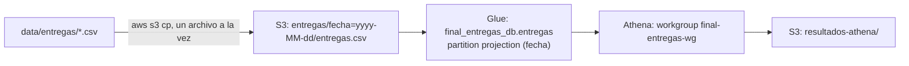

# Punto 1 (3.0) — Intentos de entrega: S3 + Glue (partition projection) + Athena

Enunciado: <https://github.com/smm-0216/DE-Final-Entregas>.



## Prerrequisitos

- Terraform ≥ 1.9 (se usó 1.9.8) con el proveedor `hashicorp/aws` 6.72.0 (fijado en `principal.tf`).
- AWS CLI v2 con un perfil con permisos sobre S3, Glue y Athena (aquí: perfil `taller`, usuario IAM
  `PedroRuedaNubeIngData`). Las credenciales viven en `~/.aws/`, nunca en el repositorio.
- Python 3.12 con `boto3` para el ejecutor de consultas (`scripts/ejecutar_athena.py`).
- Región: **us-east-2 (Ohio)**.

## Recursos (todos definidos en Terraform, en `infraestructura/`)

| Recurso | Nombre |
|---|---|
| Bucket S3 privado (bloqueo de acceso público, sin ACL, SSE-S3) | `final-entregas-pedro-rueda-466494951615` |
| Prefijo de datos | `entregas/` (`entregas/fecha=<fecha>/entregas.csv`) |
| Prefijo de resultados de Athena | `resultados-athena/` |
| Base de datos de Glue | `final_entregas_db` |
| Tabla externa | `final_entregas_db.entregas` |
| Workgroup de Athena (ubicación forzada en `resultados-athena/`) | `final-entregas-wg` |

Tabla `entregas`: columnas `id_envio string, ciudad string, transportadora string, estado string, duracion_minutos int`
(orden del encabezado), `LazySimpleSerDe` con `field.delim = ","` y `skip.header.line.count = 1`, clave de partición
`fecha string` (no es columna del CSV) y estas propiedades:

| Propiedad | Valor |
|---|---|
| `projection.enabled` | `true` |
| `projection.fecha.type` | `date` |
| `projection.fecha.format` | `yyyy-MM-dd` |
| `projection.fecha.range` | `2026-10-01,2026-10-03` (ambos incluidos, desde el despliegue inicial) |
| `projection.fecha.interval` / `.interval.unit` | `1` / `DAYS` |
| `storage.location.template` | `s3://<bucket>/entregas/fecha=${fecha}/` (prefijo de la partición, termina en `/`) |

No se crean particiones individuales (ni en Terraform ni con crawlers / `MSCK REPAIR` / `ALTER TABLE ADD PARTITION`).

## Pasos realizados (reproducibles)

Todos los comandos desde `punto1_entregas/`.

### 1. Despliegue

```bash
export AWS_PROFILE=taller AWS_REGION=us-east-2 AWS_DEFAULT_REGION=us-east-2
cd infraestructura
terraform init
terraform plan -out=entregas.tfplan
terraform apply entregas.tfplan                  # salida completa en evidencias/aplicacion_terraform.txt
terraform output -json > ../evidencias/outputs.json
cd ..
```

Comprobación: `aws glue get-table --database-name final_entregas_db --name entregas` (guardado en
`evidencias/tabla_glue.json`) muestra las propiedades `projection.*`, y `aws glue get-partitions` devuelve **0** particiones.

### 2. Etapa inicial: solo días 1 y 2 (un archivo a la vez, nada recursivo)

```bash
B=final-entregas-pedro-rueda-466494951615
aws s3 cp "data/entregas/fecha=2026-10-01/entregas.csv" "s3://$B/entregas/fecha=2026-10-01/entregas.csv"
aws s3 cp "data/entregas/fecha=2026-10-02/entregas.csv" "s3://$B/entregas/fecha=2026-10-02/entregas.csv"
```

El archivo del día 3 se conserva localmente.

### 3. Consultas de la etapa inicial

`scripts/ejecutar_athena.py <etapa> <archivo.sql> <salida.csv>...` ejecuta cada sentencia del `.sql` en el workgroup
`final-entregas-wg`, guarda el resultado de Athena como CSV (encabezado, coma, sin comillas, LF) y agrega una fila a
`evidencias/ejecuciones_athena.csv` (`etapa,archivo_sql,id_ejecucion,archivo_resultado`).

```bash
python scripts/ejecutar_athena.py inicial consultas/verificacion_etapa_inicial.sql resultados/inicial/verificacion_etapa_inicial.csv
python scripts/ejecutar_athena.py inicial consultas/intentos_por_fecha_estado.sql resultados/inicial/intentos_por_fecha_estado.csv
python scripts/ejecutar_athena.py inicial consultas/porcentaje_exito_por_fecha_ciudad.sql resultados/inicial/porcentaje_exito_por_fecha_ciudad.csv
python scripts/ejecutar_athena.py inicial consultas/duracion_promedio_2026-10-02.sql resultados/inicial/duracion_promedio_2026-10-02.csv

diff resultados/inicial/intentos_por_fecha_estado.csv resultados_esperados/intentos_por_fecha_estado_inicial.csv
diff resultados/inicial/porcentaje_exito_por_fecha_ciudad.csv resultados_esperados/porcentaje_exito_por_fecha_ciudad_inicial.csv
diff resultados/inicial/duracion_promedio_2026-10-02.csv resultados_esperados/duracion_promedio_2026-10-02.csv
```

Resultado: **12 registros** (2 fechas con datos, 0 del 2026-10-03 aunque ya está en el rango) y los tres `diff` vacíos:
los resultados son idénticos a las referencias.

### 4. Etapa final: incorporar el día 3 (solo subir y consultar)

```bash
cd infraestructura && terraform plan -detailed-exitcode; cd ..   # exit 0: la infraestructura no cambia
aws s3 cp "data/entregas/fecha=2026-10-03/entregas.csv" "s3://$B/entregas/fecha=2026-10-03/entregas.csv"
aws glue get-partitions --database-name final_entregas_db --table-name entregas --query 'length(Partitions)'   # 0

python scripts/ejecutar_athena.py final consultas/verificacion_tercer_dia.sql \
  resultados/final/verificacion_tercer_dia.csv \
  resultados/final/verificacion_tercer_dia_conteo_estado.csv \
  resultados/final/verificacion_tercer_dia_total.csv
python scripts/ejecutar_athena.py final consultas/intentos_por_fecha_estado.sql resultados/final/intentos_por_fecha_estado.csv
python scripts/ejecutar_athena.py final consultas/porcentaje_exito_por_fecha_ciudad.sql resultados/final/porcentaje_exito_por_fecha_ciudad.csv

diff resultados/final/intentos_por_fecha_estado.csv resultados_esperados/intentos_por_fecha_estado_final.csv
diff resultados/final/porcentaje_exito_por_fecha_ciudad.csv resultados_esperados/porcentaje_exito_por_fecha_ciudad_final.csv
```

Sin crawlers, sin `MSCK REPAIR TABLE`, sin `ALTER TABLE ADD PARTITION`, sin tocar la tabla ni el rango. Resultado:

- `verificacion_tercer_dia.csv`: los **6 registros** de 2026-10-03 (ENV-013 a ENV-018).
- `verificacion_tercer_dia_conteo_estado.csv`: `destinatario_ausente 3`, `direccion_incorrecta 1`, `entregado 2`.
- `verificacion_tercer_dia_total.csv`: **18 registros**, 3 fechas, 6 del día 3, 18 envíos distintos.
- Las consultas de intentos y porcentaje (sin filtro de fecha) incluyen el día 3 y son idénticas a las referencias finales.
- La duración promedio sigue siendo la del día 2: `36.67` (25, 35 y 50 minutos; los fallidos con 0 no cuentan).

Las consultas no tienen filtro de fechas, salvo la duración (fija en el 2026-10-02 por enunciado), así que no hubo que
cambiar el SQL entre etapas.

### 5. Limpieza

Primero se guardan y versionan todas las evidencias. Luego:

```bash
cd infraestructura
terraform destroy          # force_destroy = true: vacía el bucket (datos + resultados de Athena) y lo elimina
                           # salida completa en evidencias/eliminacion_terraform.txt
```

Después se verifica con la CLI que no quedan bucket, base, tabla ni workgroup (al final de `eliminacion_terraform.txt`).

## Contenido

| Ruta | Contenido |
|---|---|
| `infraestructura/principal.tf`, `variables.tf`, `salidas.tf` | Terraform: proveedor, recursos y propiedades de proyección; variables; outputs |
| `consultas/*.sql` | Consultas de las dos etapas (`verificacion_etapa_inicial.sql` es una verificación adicional de los 12 registros) |
| `resultados/inicial/`, `resultados/final/` | Resultados obtenidos en Athena por etapa |
| `resultados_esperados/`, `data/` | Material suministrado, sin modificar |
| `evidencias/aplicacion_terraform.txt`, `outputs.json`, `tabla_glue.json` | Plan + apply, outputs y propiedades de la tabla en Glue |
| `evidencias/ejecuciones_athena.csv` | Cada ejecución: etapa, archivo SQL, id de ejecución de Athena, archivo de resultado |
| `evidencias/eliminacion_terraform.txt` | Destroy y verificación de limpieza |
| `scripts/ejecutar_athena.py` | Ejecutor de consultas y registro de ejecuciones |
| `respuestas.md` | Respuestas conceptuales |

## Capturas de respaldo (opcionales)

Tomadas en la consola de AWS (us-east-2) después de la etapa final y antes del destroy, en `evidencias/capturas/`:
bucket y prefijos `entregas/fecha=...` (`p1_01`, `p1_02`), tabla de Glue con detalle, propiedades de proyección y esquema
(`p1_03` a `p1_05`), workgroup de Athena con su ubicación de resultados (`p1_06`) e historial de consultas con los mismos
IDs de `evidencias/ejecuciones_athena.csv` (`p1_07`). La evidencia exigida por el enunciado son los archivos de texto.
